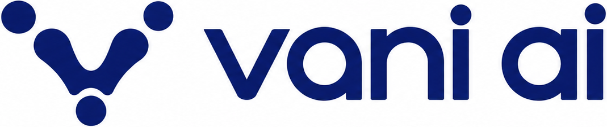

<div align="center">



### Every abnormal screening result gets an owner, until it is closed.


</div>

**vani.ai** is a case-management dashboard for clinics and hospitals. It makes sure every abnormal screening result has a named owner until care is closed with evidence. Its assistant, **Vani**, reminds patients (and family, with consent) on WhatsApp, asks why a follow-up visit was missed, helps with that barrier, and hands the case to a nurse or doctor when a person is needed.

The prototype covers one complete pathway: **people with high blood pressure found in community screening (CKG) who do not come back for follow-up.**

---

## Technical documentation

### 1. System overview and scope

| | |
|---|---|
| **Problem** | Screening finds abnormal results, but follow-up is lost between programs, clinics and apps. In Indonesia, about 1 in 3 people with high blood pressure from CKG came back for a check the next year. |
| **Users** | Care coordinator (nurse), doctor, facility manager. Patients and family only use WhatsApp. |
| **Prototype scope** | Hypertension after screening → reminder → reason for no-show → hand-over → visit → closure with evidence. |
| **Out of scope (for now)** | Diabetes, cervical screening, hospital referrals, live national records. |

### 2. Architecture: deterministic rules + AI layer + people

```
Screening result ─► Case (owner)
                      │
     Rule engine ─────┤  timing, urgency, hand-over, closure guard   (deterministic)
     AI layer ────────┤  read free text → reason, draft plain message (simulated in prototype)
     People ──────────┘  take over, schedule, clinical decision, close case
```

| Layer | Responsibility | In the prototype |
|---|---|---|
| **Rule engine** (`logic/engine.ts`, `logic/constants.ts`) | First contact day 1 · medicine reminder day 12 · **overdue day 15** · contact family after 3 days without reply · **hand over after 7 days** · danger-sign keywords → urgent · AI confidence < 70% → hand over · closure only with evidence | Runs live on every demo-clock tick |
| **AI layer** (`logic/simulated-ai.ts`) | Map free-text replies to 8 barrier reasons with a confidence score; answer only from doctor-approved content | **Simulated** (keyword rules, same input/output contract as a model) and labelled "Simulated AI" in the UI |
| **Human in the loop** | Take over / return to Vani, schedule and record visits, escalate to a doctor, clinical decisions, close case | Fully working, with role-based views |

**AI can raise urgency, never lower it.** Danger signs are decided by a fixed rule, not by the model.

### 3. Data model and interoperability (HL7 FHIR)

The demo data is stored in the browser, but every entity maps to a FHIR resource. This is the basis for later integration with SATUSEHAT (Indonesia) and Malaffi (Abu Dhabi).

| vani.ai | FHIR resource | Purpose |
|---|---|---|
| Patient | `Patient` | Person screened |
| Family contact | `RelatedPerson` | Optional helper |
| Family consent | `Consent` | Who may receive what (3 levels) |
| Screening result | `Observation` | Blood pressure reading |
| Case + owner | `Task` | Owner, status, due dates |
| Visit booking | `Appointment` | Scheduled follow-up |
| Visit record | `Encounter` | Evidence for closing a case |
| WhatsApp message | `Communication` | Conversation log |
| Urgent marker | `Flag` | Danger sign / doctor review |
| Timeline entry | `AuditEvent` | Who did what, when |

Local insurance and referral rules are a swappable **rule pack** (demo: generic; next: JKN for Indonesia, Thiqa / Daman for Abu Dhabi).

### 4. Clinical safety, privacy and data governance

- **Not a diagnostic tool.** Vani never diagnoses, changes doses or closes a case.
- **Danger signs** (e.g. chest pain, blurred vision, slurred speech) go straight to a doctor via a fixed rule.
- **Approved content only.** Health answers come from a library approved by doctors; anything else goes to staff.
- **Privacy by design.** The first WhatsApp message does not name a diagnosis. The family channel is opt-in, has 3 sharing levels, can be revoked, and is off by default for sensitive topics.
- **Role-based access.** Facility managers see aggregated numbers only (no names, no messages).
- **Audit trail.** Every hand-over, message, booking and closure is logged with the actor and day.

### 5. Evaluation: test scenarios (synthetic data)

| # | Scenario | Expected result | How to see it in the demo |
|---|---|---|---|
| 1 | **Normal flow:** missed visit → reason → hand-over → visit | Reason recorded, nurse takes over, visit booked, status moves on | Guided tour (Help) with patient *Andi* |
| 2 | **Red-flag escalation:** reply mentions a danger sign | Case turns *Urgent* and goes to the doctor queue | Patient *Lastri* · switch to Dr. Yoga |
| 3 | **No response:** patient does not reply | Day +3 → family contacted (if consent) · day +7 → handed over to staff | Advance the demo clock and watch *Siti* / *Hendra* |
| 4 | **Low AI confidence:** unclear free text | Confidence < 70% → handed to a person | Rule in `engine.ts` (`minConfidence`) |
| 5 | **Closure guard:** close without evidence | Blocked: needs 2 in-target visits, a note, or doctor approval | Case page → *Close case* |
| 6 | **Roles and audit:** take over / return to Vani | Each step logged with name and day; manager sees no patient data | Case timeline · switch account |

### 6. How to access and run

- **Live demo:** _add deployment URL_ · no login, all data synthetic
- **Guided tour:** opens on first visit; replay with **Help** in the top bar
- **Switch roles:** avatar menu (top right or sidebar) → Nurse Rina / Nurse Dewi / Dr. Yoga / Hadi (manager)
- **Demo clock:** `›` = +1 day, `»` = +3 days, to see days pass in seconds
- **Reset:** account menu → *Reset demo data*

Run locally (Bun 1.4+, Node 20+):

```bash
git clone https://github.com/sulthonaw/vani.ai-fe.git
cd vani.ai-fe
bun install
bun dev            # http://localhost:3000  ·  dashboard at /dashboard
```

Optional: set `NEXT_PUBLIC_SITE_URL` to the deployed domain (used for share-image links).

### 7. Assumptions and limitations

**Assumptions**
1. Each facility has staff who own cases, and doctors who set the clinical thresholds and approve the content library.
2. Patients have an active WhatsApp number and agree to be contacted about their screening result.
3. Facility record systems will exchange data through HL7 FHIR (at least `Observation` and `Encounter`).

**Limitations**
1. **Simulated WhatsApp and AI.** Both run locally and are labelled in the UI. A live LLM (limited to the approved library) and the WhatsApp Business API are planned for the pilot.
2. **Synthetic data only.** All patients, conversations and Insights numbers are fictional; no real medical data is used.
3. **No live EMR connection.** Not connected to SATUSEHAT, BPJS P-Care or Malaffi; this needs official authorisation.
4. **Seeded screening step.** Cases and the blood-pressure thresholds (≥ 140/90 to open, ≥ 180/120 urgent) are pre-applied in the seed data; the live engine evaluates timing, replies, hand-overs and closure.
5. **Browser storage.** Demo state lives in the viewer's browser (no backend, no login, not shared between users).
6. **One pathway.** Hypertension after screening only, before expanding to diabetes, cervical screening and referrals.
7. **Not a medical device.** Thresholds shown are demo defaults and must be set by the clinical team.

---

<sub>Built for the Future Health Digital Innovation Challenge 2026 · Challenge 05: Closing the Screening-to-Care Loop.</sub>
